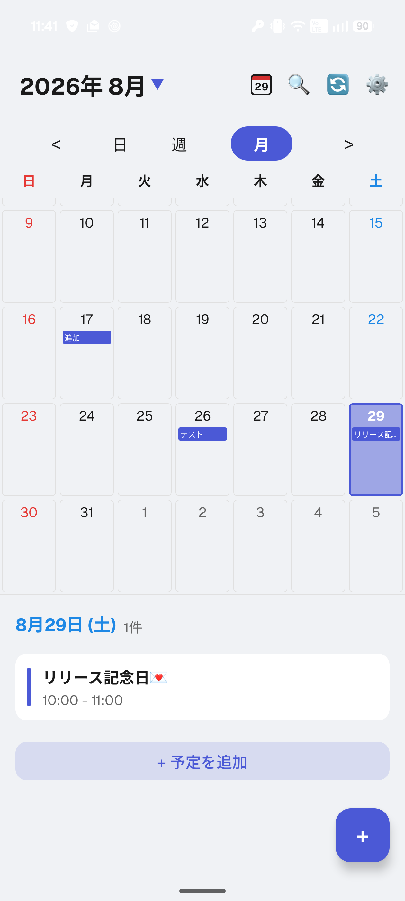
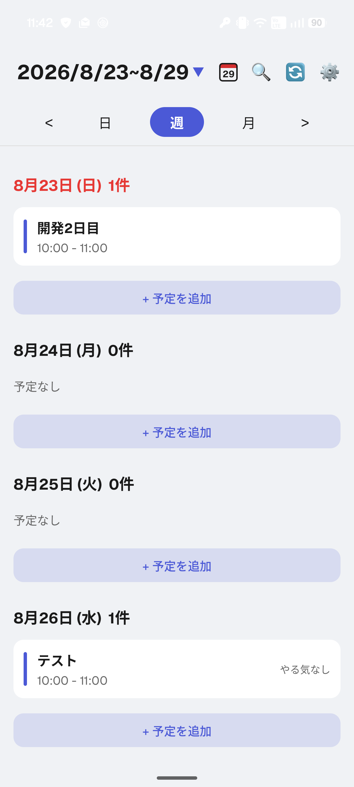
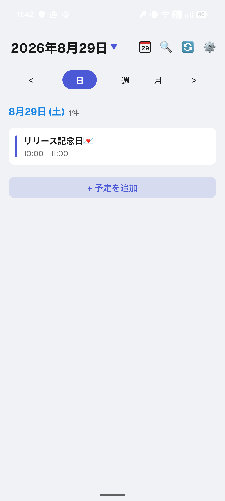
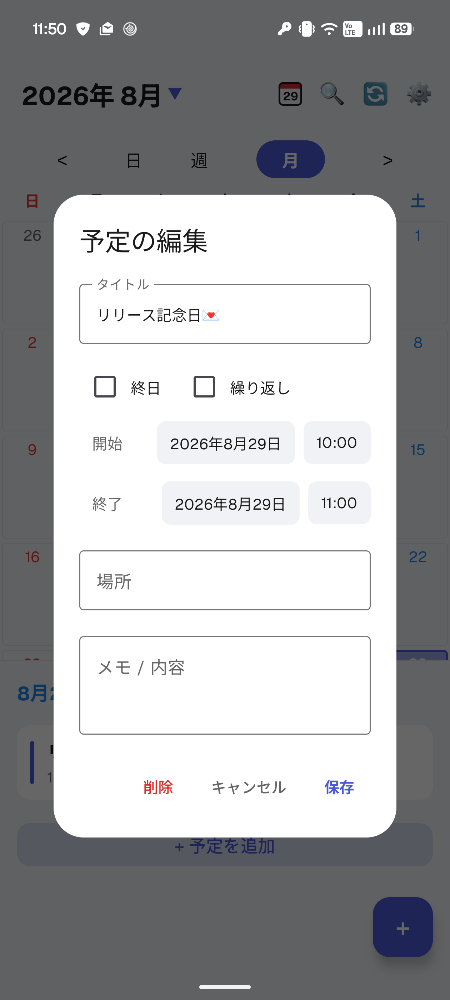
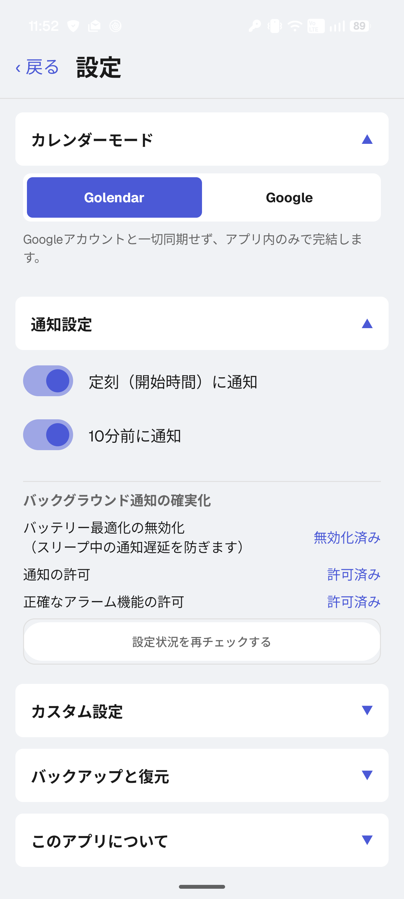
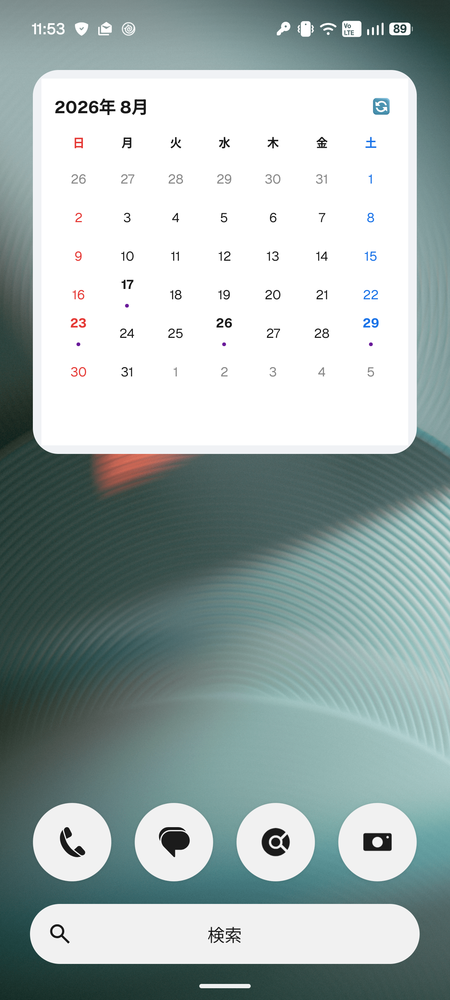

  

  <strong>Your idea, your future.</strong>

<a href="README_EN.md">English</a> · <b>日本語</b> · <a href="README_zh-CN.md">简体中文</a> · <a href="README_KO.md">한국어</a>

# 📅 Golendar

月・週・日表示を備えた Android カレンダーアプリ。
プライバシー重視の **Golendarモード**（アプリ内完結・複数ローカルカレンダー対応）と、**Googleモード**（Googleカレンダー同期）の2つを搭載。

---

## 📲 ダウンロード

最新のAPKは [GitHub Releases](https://github.com/monsivamon/Golendar/releases/latest) から。
APKを端末で開き、「不明なアプリのインストール」を許可してインストール。

---

## 📸 スクリーンショット

| 月間 | 週間 | 日間 |
|:-:|:-:|:-:|
|  |  |  |

| 予定編集 | 設定 | ウィジェット |
|:-:|:-:|:-:|
|  |  |  |

---

## ✨ 主な機能

### デュアルエンジン
- **Golendarモード**：外部同期なし。アプリ内のみで完結（祝日取得・地図表示のみネット使用）。複数のローカルカレンダーを作成・管理できます。
- **Googleモード**：Googleカレンダーと同期。

### Golendarモードの複数カレンダー対応
- アプリ内に複数のローカルカレンダーを作成し、予定を振り分けて管理できます。
- 初回起動時に「マイカレンダー」を自動作成。マイカレンダーは削除できませんが、非表示にはできます。
- カレンダーごとに名前・色・表示ON/OFF・並び順を設定可能。
- 既定カレンダー以外のカレンダーを削除すると、所属する予定もまとめて削除されます（削除前に件数を確認するダイアログを表示）。
- 予定編集画面で追加先カレンダーを選択可能（可視カレンダーが2つ以上のとき）。
- 「全て表示」で一括表示ON（非表示0にはできません）。
- 表示カレンダーが2つ以上のとき、予定カードにカレンダー名と色を表示。

### Googleカレンダーの複数カレンダー対応
- アカウント単位でカレンダーを一覧表示し、表示するものを選択。
- 設定画面で個別に表示 ON/OFF、色のカスタマイズが可能。
- 表示カレンダーが2つ以上のとき、予定カードにカレンダー名と色を表示。
- 「カレンダー一覧を再取得」で追加・削除に追従。

### カレンダービュー
- 月・週・日ビューをシームレスに切替。
- 月グリッド下の予定リストは ON/OFF 切替可能（下部リスト OFF 時は日付タップでポップアップ）。
- 月グリッドの予定バーは3件まで表示し、超過分は「+N」で表示（下部リスト OFF 時は6件まで）。下部リスト表示中は未表示アイテムがある旨のインジケータを表示。
- 予定検索（過去2年〜未来2年、祝日・文化・誕生日は除外）。
- 上下スワイプで前後の期間、左右スワイプで日・週・月タブ切替。
- 予定カードに種別絵文字（🎂 誕生日 / 🎌 文化 / 🗾 祝日）。

### 地図で場所を選択
- MapLibre Native + OpenFreeMap の地図から選択。
- 現在地追従ボタン付き。「POI名, 住所」形式で保存。

### 繰り返し予定
- 毎日 / 平日 / 毎週 / 毎月 / 毎年。終了日指定可。

### 予定の共有
- 詳細ダイアログからテキストとして他アプリへ共有。

### 写真の添付（Golendarモード専用）
- 予定に最大5枚添付。長辺1920pxに自動縮小。
- 拡大ビューア・端末の「ピクチャ/Golendar」への書出し対応。

### AI解析による予定一括登録（BETA・Golendarモード専用）
- カレンダー画像を外部AIに読み取らせ、返却JSONから予定を一括登録。
- プロンプトのコピー／共有シート対応。プレビューで選択して登録。

### アプリショートカット
- アイコン長押しで「予定追加」「今日」「検索」。

### ホーム画面ウィジェット
- 日間・週間・月間の3種類。アプリ設定（テーマ・背景色・表示カレンダー・祝日表示）と連動。
- 月間ウィジェットは前後月セルも含めて予定ドットを表示。
- Golendarモードでは可視ローカルカレンダー、Googleモードでは可視Googleカレンダーの予定を反映。

### リマインダー通知
- 定刻・10分前の通知。`AlarmManager` の正確なアラームで Doze 対策。
- 祝日・文化イベントは通知対象外。**誕生日は通知対象**（天皇誕生日は祝日扱いで除外）。
- 表示カレンダー設定と連動（Golendar/Google 両モードの可視カレンダーが対象）。

### 初回起動時のセットアップ
0. Welcome 画面（初回起動時、およびバージョンアップ時に表示）
1. 通知の許可（通知 → 正確なアラーム → バッテリー最適化の無効化）
2. Google カレンダーへのアクセス許可
3. 表示するカレンダーの選択（Googleモード時）
4. ジェスチャー操作の案内

位置情報は初めて地図を開いたときに案内。

### バックアップ＆復元
- **可視カレンダーの予定をまとめて書き出します**（Golendar/Google 両モード）。
- 「写真もバックアップ」ON 時は ZIP（Golendarモードのみ）。OFF 時は JSON。
- バックアップファイルには「元カレンダー情報」が含まれ、復元時にカレンダーごとの振り分けが可能です。
- 複数カレンダー表示中に「保存」を押すと、対象一覧を確認するダイアログを表示。
- ファイル名に日付を付与（例: `golendar_backup_YYMMDD.json`）。
- **復元前プレビュー**：ファイル選択後に含まれるカレンダー数・予定数・写真数を確認できます。
- **復元する元カレンダーを選択**：チェックボックスで複数選択できます（旧形式バックアップでは自動的に非表示）。
- **復元先の指定**：
  - Googleモード：復元先カレンダーを1つ選択。
  - Golendarモード：「同名カレンダーを自動作成して振り分け」または「特定のローカルカレンダーへ集約」を選択。
- **同名カレンダー上書き確認**：Golendarモードで同名カレンダーが既存の場合、上書きするか確認するダイアログを表示。
- **追記時の重複スキップ**：タイトル・開始・終了・終日フラグが一致する予定は重複登録しません。
- **旧形式（v1.1.6以前）のバックアップ互換**：追記は Google/Golendar どちらも可能（追記先カレンダーを選択）。復元（上書き）は Golendar モードのみ、マイカレンダーへ復元。旧形式 ZIP の Google モード追記は不可。
- Googleモードでは「復元（上書き）」不可、「追記」のみ可。
- 祝日データは含まれず、復元時に自動再取得。

### 祝日・文化イベント
- `holidays-jp` API から自動取得（初回＋30日ごと）。
- 祝日・文化・誕生日を自動判別し、色と絵文字で表示。
- 設定画面で「祝日を表示」ON/OFF 切替可。
- 祝日はカレンダーの表示ON/OFFに関わらず常に表示対象。

### チュートリアル
- 設定画面の「チュートリアル」から、いつでも13種以上の案内を再表示できます。
- 内容：カレンダーのアクセス権限 / ジェスチャー操作 / 地図の使い方 / AI解析 / カレンダーの表示と色の設定 / 月表示の下部リスト / 予定の追加 / 予定の編集と削除 / 繰り返し予定 / 写真の活用 / 検索の使い方 / 通知の設定 / バックアップと復元 / ウィジェットとショートカット
- 「カレンダーモード」セクションを初めて展開した際は、Golendar/Google の違いとカレンダー一覧の操作方法を自動表示します。
- 各チュートリアルは図解付きの複数ページ構成で、落とし穴（繰り返しの終了日、この日だけ削除の分割挙動、追記と復元の違い、非表示カレンダーの影響など）も丁寧に解説しています。

---

## 🎨 カスタマイズ

- テーマ：ライト / ダーク / システム追従
- 言語：日本語 / English / 简体中文 / 한국어（設定画面の「表示言語」セクションから切替。切替後も設定画面にとどまる。未選択時は端末の言語から自動判定）
- アプリ背景色：16色のパステルカラー（カレンダー・設定・ウィジェット連動）
- 曜日の色：全曜日に設定可
- カレンダーごとの色：**Golendarモード・Googleモードの両方**で個別設定可能。テーマに応じて自動割り当て（ライト=濃色16色 / ダーク=明色16色）。
- イベント色分け：誕生日=オレンジ、文化=緑、通常=テーマカラー（カレンダー色優先）
- 週の始まり：日曜 / 月曜
- 祝日表示：ON/OFF

---

## 🛠 使用技術

| カテゴリ | 技術 |
|---|---|
| 言語 | Kotlin |
| UI | Jetpack Compose |
| ナビゲーション | Navigation Compose |
| ウィジェット | Jetpack Glance |
| ローカルDB | Room |
| 設定 | Preferences DataStore |
| バックグラウンド | Coroutines, AlarmManager, WorkManager |
| 地図 | MapLibre Native GL（OpenFreeMap） |
| 逆ジオコーディング | Nominatim, 国土地理院 |
| 画像読込 | Coil |
| アーキテクチャ | MVVM |

---

## ⚠️ 注意点

- **カレンダー権限**：Googleモード時は `READ_CALENDAR` / `WRITE_CALENDAR` が必要。拒否時は自動で Golendar モードへ。Google アカウントが無い場合は切替時に案内表示。恒久的に拒否された場合は設定画面へ誘導するダイアログを表示します。
- **表示カレンダー**：**最低1つのカレンダーを表示する必要があります**（0にはできません）。Golendarモードではマイカレンダーが削除不可のため、常に1つ以上は残ります。Googleモードでカレンダーを追加・削除した後は「カレンダー一覧を再取得」を実行してください。
- **ローカルカレンダーの削除**：既定（マイカレンダー）以外のローカルカレンダーを削除すると、所属する予定もまとめて削除されます。削除前に件数を確認するダイアログが表示されます。
- **Googleモードの切替**：v1.1.7 では、権限が許可済みであればアプリ再起動なしで即座に切り替わります。
- **通知**：バッテリー最適化の無効化と正確なアラームの許可を推奨。一部メーカー端末では遅延あり。
- **地図**：要ネット接続。位置情報を拒否しても地図機能は使える。
- **検索**：祝日・文化・誕生日は除外。
- **繰り返し**：「終了」は1回分の所要時間。全体の終了日は別途指定。
- **祝日データ**：オフライン時は最後に取得したデータを表示。
- **バックアップ**：Googleモードでは「復元（上書き）」不可、「追記」のみ可。復元先カレンダーは書き込み可能なカレンダーから選択します。
- **旧形式バックアップ**：v1.1.6 以前のバックアップは、追記なら Google/Golendar どちらも可能です（追記先カレンダーを選択）。復元（上書き）は Golendar モードのみ（マイカレンダーへ復元）。旧形式 ZIP を Google モードで追記する場合は、事前に Golendar モードへ切り替えてください。
- **写真添付**：Golendarモード専用。クラウド自動バックアップからは除外。
- **AI解析**：Golendarモード専用。解析結果はローカルDBのみ反映。

---

## 🙏 Credits

### データ・API
- 祝日データ：[holidays-jp](https://github.com/holidays-jp/date.json)（MIT）
- 地図データ：[OpenStreetMap](https://www.openstreetmap.org/) contributors（ODbL）
- タイル配信：[OpenFreeMap](https://openfreemap.org/)
- 逆ジオコーディング：[Nominatim](https://nominatim.org/) / [国土地理院](https://mreversegeocoder.gsi.go.jp/)

### ライブラリ
- MapLibre Native for Android（BSD-2-Clause）
- AndroidX / Jetpack（Apache 2.0）
- Kotlin（Apache 2.0）
- Coil（Apache 2.0）

### アセット
- Android robot：Google 作成（CC BY 3.0）

---

## 📄 ライセンス

[GNU General Public License v3.0 (GPLv3)](LICENSE)

### サードパーティライセンス

| 名称 | ライセンス |
|---|---|
| Kotlin, AndroidX, Jetpack Compose, Room, DataStore, Glance, WorkManager | Apache 2.0 |
| Coil | Apache 2.0 |
| MapLibre Native for Android | BSD-2-Clause |
| OpenStreetMap データ | ODbL 1.0 |
| Nominatim | GPL v2（サービス利用） |
| holidays-jp | MIT |